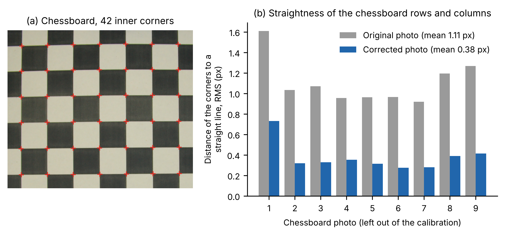

# 1. Image corrections

Corrections are optional and independent of each other. When several are active, they are
applied in this order, on the full-resolution photo and in memory (the original file is not
changed):

**lens distortion → perspective → color → scale → working resolution**

When an active correction cannot be applied to a photo (the ArUco markers or the color card
are not found, or the photo has a different aspect ratio than the calibration), the photo is
skipped and exported with `status = skipped`. A data set therefore contains only photos that
received the same corrections.

## 1.1 Lens distortion

**Camera model.** FenotIT uses the camera model of OpenCV (Bradski, 2000), with the radial
and tangential distortion terms of Brown (1966). The model has two parts:

- the *camera matrix*, with the focal length in pixels along each axis ($f_x$, $f_y$) and the
  image point where the optical axis falls ($c_x$, $c_y$);
- five *distortion coefficients*: three radial ($k_1$, $k_2$, $k_3$), which bend straight lines
  more and more towards the edges of the frame, and two tangential ($p_1$, $p_2$), which
  appear when the lens is not exactly parallel to the sensor.

A point at position $(x, y)$ relative to the optical center (in units of the focal length),
at distance $r$ from it ($r^2 = x^2 + y^2$), appears in the photo at

$$x_d = x\,(1 + k_1 r^2 + k_2 r^4 + k_3 r^6) + 2 p_1 x y + p_2 (r^2 + 2x^2)$$
$$y_d = y\,(1 + k_1 r^2 + k_2 r^4 + k_3 r^6) + p_1 (r^2 + 2y^2) + 2 p_2 x y$$

**Calibration.** The camera matrix and the coefficients are estimated with Zhang's method
(Zhang, 2000) from 10 to 40 photos of a flat chessboard taken with the same camera, lens and
zoom. The inner corners of the board are found on a copy of at most 1600 px and then located
to a fraction of a pixel on the full photo (`cornerSubPix`). For each photo FenotIT reports the
reprojection error, the distance between the corners found and the corners predicted by the
fitted model; a photo is flagged when its error is larger than 2.5 times the median of all
photos and larger than 0.5 px. When more than 40 photos are given, 40 are taken evenly spaced.

**Correction.** Each photo is remapped so that straight lines become straight, keeping all
source pixels (OpenCV's optimal camera matrix with $\alpha = 1$) and cropping to the valid
region. These are the same settings as the calibration scripts used by the Bean Physiology
team, so their calibration files (`.npz`) load unchanged. A calibration made at one
resolution is applied to photos of another resolution with the same aspect ratio by scaling
the focal lengths and the optical center by the ratio of widths and heights.

**Result on real photos.** Figure 1.1 uses the nine chessboard photos taken in the capture box
of the bean seed photos (4040 × 3040 px, 7 × 6 inner corners). Each photo was left out in turn,
the camera was calibrated with the other eight, and the left-out photo was corrected. On a
flat board the corners of each row and column lie on a straight line, so the distance from
each corner to the line fitted through its row or column measures the remaining distortion.

| Capture box | Photos | Corners off a straight line (RMS), original | Corrected | Largest deviation, original → corrected |
|---|---|---|---|---|
| Durango seeds | 9 | 1.11 px | 0.38 px (−66 %) | 5.0 → 2.4 px |
| Drought seeds | 7 | 1.01 px | 0.43 px (−57 %) | 3.7 → 1.5 px |

The reprojection error of the full calibration was 1.01 px (Durango) and 1.12 px (drought). The
camera of these boxes bends lines by about one pixel, and the correction removes about two
thirds of it. In all photos the chessboard covers the center of the frame; the correction is
estimated best where the board was placed, so photos of the board that also reach the
corners of the frame extend the zone where the model is fitted to data.

*Figure 1.1. Lens calibration in the capture box of the bean seed photos. (a) Inner corners
found on one chessboard photo. (b) For each photo, the RMS distance of its corners to the
straight line through their row or column, in the original photo (gray) and after the
correction calibrated without that photo (blue).*

## 1.2 Perspective (ArUco markers)

Four ArUco markers (dictionary `DICT_4X4_50`; Garrido-Jurado et al., 2014) with IDs 0 to 3 are
placed at the corners of the working surface: 0 top left, 1 top right, 2 bottom right and
3 bottom left. When the camera is tilted, the rectangle they form appears as a general
quadrilateral. FenotIT computes the plane homography (Hartley & Zisserman, 2004) that takes the
four marker centers to the corners of a rectangle and resamples the photo with bilinear
interpolation, so the surface looks as if photographed from straight above.

The size of the target rectangle keeps the real proportions of the surface:

- **Without measurements**, the width of the rectangle is the mean length, in pixels, of the
  top and bottom sides of the quadrilateral, and its height the mean length of the left and
  right sides.
- **With the real distances** between the markers (ID 0 to ID 1 for the width, ID 0 to ID 3 for
  the height, in mm), FenotIT computes the pixels per millimeter along each direction, takes
  their mean, and builds the rectangle with the real width and height at that density. The
  scale of the photo is then 1 / (pixels per millimeter), in mm/px.

Each photo thus carries its own scale, measured from its own markers.

## 1.3 Color (color card)

**Finding the card.** The card is searched on a copy of at most 1600 px. Candidate patches are
smooth, nearly square regions enclosed by edges in the three CIELAB channels (sides in a ratio
of at most 1.35, filling at least 85 % of their bounding box). The largest group of candidates
spaced like a grid is the card. The direction of the grid is taken from the directions between
neighboring patches, which gives the row and column of each patch at any rotation of the card.
A homography from the row and column numbers to the image (RANSAC, tolerance a quarter of the
patch spacing) places the patches that were not found as candidates; in Figure 1.2a, 23
patches were found directly and one was placed by the grid.

**Measuring.** The color of each patch is the mean of its central 40 %, away from the edges.
The card may appear in any of four 90° rotations; FenotIT uses the rotation whose correction
fits the reference colors best.

**Correction model.** As in PlantCV (Berry et al., 2018), each corrected color is a linear
combination of the measured red, green and blue values plus a constant, with colors scaled
from 0 to 1:

$$\begin{pmatrix} R' & G' & B' \end{pmatrix} = \begin{pmatrix} R & G & B & 1 \end{pmatrix} M$$

where $M$ is a table of 4 × 3 numbers fitted by least squares so that the measured patches
come as close as possible to their reference values. A patch with glare or shadow does not fit
the others; FenotIT leaves out, one at a time and at most four, the patch farthest from its
reference while that distance is more than three times the median distance and more than
0.08. The reference is one of: the published values of the 24-patch ColorChecker (McCamy et
al., 1976), the values given by the card maker, or the colors of the card in a reference photo
(all photos are then matched to that photo).

**White balance.** With a white or gray card only, each channel is multiplied by the factor that
makes the marked area neutral (or equal to the reference photo).

**Result on real photos.** The color difference between each patch and its reference was
measured with CIEDE2000 (ΔE₀₀; Sharma et al., 2005), the CIE formula that weights differences
in lightness, chroma and hue as they are perceived. A ΔE₀₀ near 1 is the smallest difference
noticed side by side; values from 2 to 10 are differences seen at a glance. To measure each
patch with a correction that did not use it, the correction was fitted 24 times, each time
without one patch (leave-one-out).

| Card | Before | After (leave-one-out) | Largest, before → after | Gray patches 19–24, after |
|---|---|---|---|---|
| Durango seed box | 9.9 | 4.1 | 18.2 → 9.4 | 6.4 |
| Drought seed box | 10.0 | 3.9 | 16.7 → 8.9 | 6.0 |
| CameraTrax card (test photo) | 10.2 | 4.7 | 19.8 → 8.6 | 6.9 |

The correction reduces the mean difference to 40–46 % of its original value. The colored
patches improve the most; the white and the two lightest grays (patches 19 to 21) end with a
difference similar to or larger than before (Figure 1.2d). In both seed boxes patches 19 and 20
are the ones left out by the glare rule, and a single linear correction for the whole card
fits the colored patches and the light neutrals together.

*Figure 1.2. Color correction with the card of the Durango seed box. (a) The 24 patches, numbered
in the order of the reference. (b, c) Each square shows the reference color around and the
photographed color in the center, before and after the correction; the number under each
square is ΔE₀₀. (d) ΔE₀₀ of each patch before (gray) and after (blue) the correction, each
patch corrected with a fit that did not include it.*

## 1.4 Scale

The scale is the length that one pixel represents (mm per pixel by default; µm, cm or m can be
chosen). For each photo it comes from the first available source:

1. **The photo's own scale**, set by clicking two points a known distance apart: the scale is
   that distance divided by the distance in pixels between the two points.
2. **ArUco markers** with real distances (section 1.2).
3. **The scale for all photos**, set with two points or typed.
4. **No scale**: results stay in pixels.

## 1.5 Working resolution

After the corrections, a photo larger than the working resolution (50 megapixels by default)
is reduced so that its pixel count equals that value, with area interpolation, and the scale
is multiplied by the same factor. Results in real units are therefore the same at both
resolutions, while very large phone photos (for example 200 MP) are analyzed with the memory of
an ordinary computer. The reduction factor is exported as `work_scale`. In a test with a 69 MP
photo reduced to 20 MP, object areas in mm² differed by less than 2 %.
