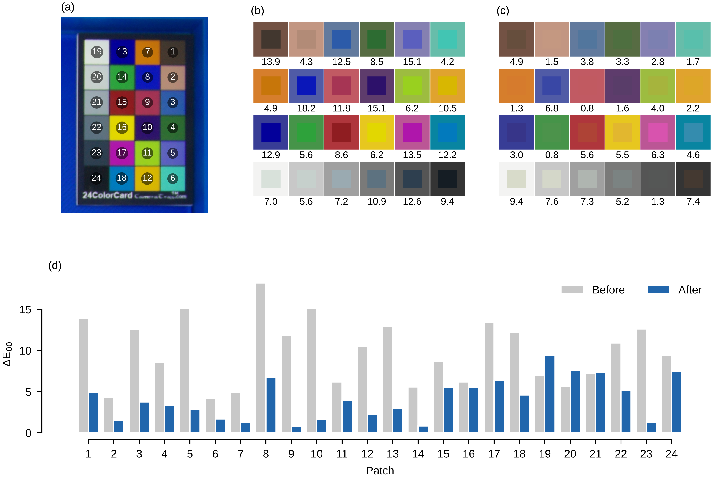

# 1. Image corrections

Corrections are optional. Active corrections are applied in memory to the full-resolution
photo in this order: lens distortion, perspective, color, scale and working resolution. A photo
whose markers, card or calibration size are not found is exported with `status = skipped`.

## 1.1 Lens distortion

FenotIT uses the OpenCV camera model (Bradski, 2000) with the radial and tangential terms of
Brown (1966): a camera matrix (focal lengths $f_x$, $f_y$ and optical center $c_x$, $c_y$) and
five coefficients. A point $(x, y)$ relative to the optical center, at distance $r$, appears at

```latex
x_d = x\,(1 + k_1 r^2 + k_2 r^4 + k_3 r^6) + 2 p_1 x y + p_2 (r^2 + 2x^2)
y_d = y\,(1 + k_1 r^2 + k_2 r^4 + k_3 r^6) + p_1 (r^2 + 2y^2) + 2 p_2 x y
```

The parameters are estimated with Zhang's method (Zhang, 2000) from 10 to 40 photos of a flat
chessboard. Corners are found on a copy of at most 1600 px and refined to sub-pixel precision
on the full photo. A photo is flagged when its reprojection error exceeds 2.5 times the median
and 0.5 px. Photos are remapped with OpenCV's optimal camera matrix ($\alpha = 1$) and cropped
to the valid region; `.npz` files with this format load directly. A calibration is applied to
other resolutions with the same aspect ratio by scaling the camera matrix.

**Evaluation.** Each chessboard photo of the bean seed capture boxes was corrected with a
calibration made from the others. The area of each square was compared with its area on a flat
board seen through the same perspective (a homography fitted to all corners).

| Capture box | Photos | Square area error, original | Corrected | Largest, original → corrected |
|---|---|---|---|---|
| Durango seeds | 9 | 0.76 % | 0.32 % | 2.2 → 1.0 % |
| Drought seeds | 7 | 0.66 % | 0.31 % | 1.6 → 1.0 % |


*Figure 1.1. Lens calibration in the Durango capture box. (a) Inner corners found on one
chessboard photo. (b) Mean area error of the squares in each photo, original (gray) and
corrected (blue).*

## 1.2 Perspective (ArUco markers)

Four ArUco markers (`DICT_4X4_50`; Garrido-Jurado et al., 2014), IDs 0 to 3 from the top left
clockwise, mark the corners of the working surface. The plane homography (Hartley & Zisserman,
2004) that takes their centers to a rectangle is applied with bilinear interpolation. The
rectangle has the mean lengths of opposite sides of the quadrilateral or, when the real
distances between markers are given (ID 0 to 1 for width, ID 0 to 3 for height), the real
proportions at the mean pixel density; each photo then gets its own scale in mm/px.

## 1.3 Color (color card)

The card is searched on a copy of at most 1600 px as a group of smooth, nearly square patches
spaced like a grid. The row and column of each patch come from the dominant directions between
neighbors, and a RANSAC homography places patches that were not found. The color of a patch is
the mean of its central 40 %, and the card rotation (in steps of 90°) is the one that fits the
reference best.

As in PlantCV (Berry et al., 2018), corrected colors are an affine function of the measured
values scaled from 0 to 1:

```latex
\begin{pmatrix} R' & G' & B' \end{pmatrix} = \begin{pmatrix} R & G & B & 1 \end{pmatrix} M
```

with $M$ (4 × 3) fitted by least squares. The patch farthest from its reference is dropped and
the fit repeated while its distance is more than three times the median and above 0.08 (up to
four patches). The reference is the published ColorChecker values (McCamy et al., 1976), values
given by the card maker, or the card in a reference photo. A white or gray card gives a white
balance instead.

**Evaluation.** Color differences were measured with CIEDE2000 (ΔE₀₀; Sharma et al., 2005),
each patch corrected with a fit to the other 23.

| Card | Before | After | Largest, before → after |
|---|---|---|---|
| Durango seed box | 9.9 | 4.1 | 18.2 → 9.4 |
| Drought seed box | 10.0 | 3.9 | 16.7 → 8.9 |
| CameraTrax card (test photo) | 10.2 | 4.7 | 19.8 → 8.6 |

Colored patches improve the most. The lightest patches keep part of their difference because
the camera compresses light tones (white recorded at 85 % of full scale against a reference of
95 %).



*Figure 1.2. Color correction with the card of the Durango seed box. (a) Patches numbered in
reference order. (b, c) Reference color around and photographed color in the center, before
and after correction, with ΔE₀₀ below. (d) ΔE₀₀ of each patch before (gray) and after (blue).*

## 1.4 Scale

The scale (mm per pixel by default; µm, cm or m can be chosen) comes from the first available
source: the photo's own two-point scale, ArUco markers with real distances, the scale set for
all photos, or none (results in pixels).

## 1.5 Working resolution

After the corrections, photos larger than the working resolution (50 MP by default) are reduced
with area interpolation and the scale is multiplied by the same factor (`work_scale` in the
export). A 69 MP photo reduced to 20 MP gave object areas within 2 % in mm².
