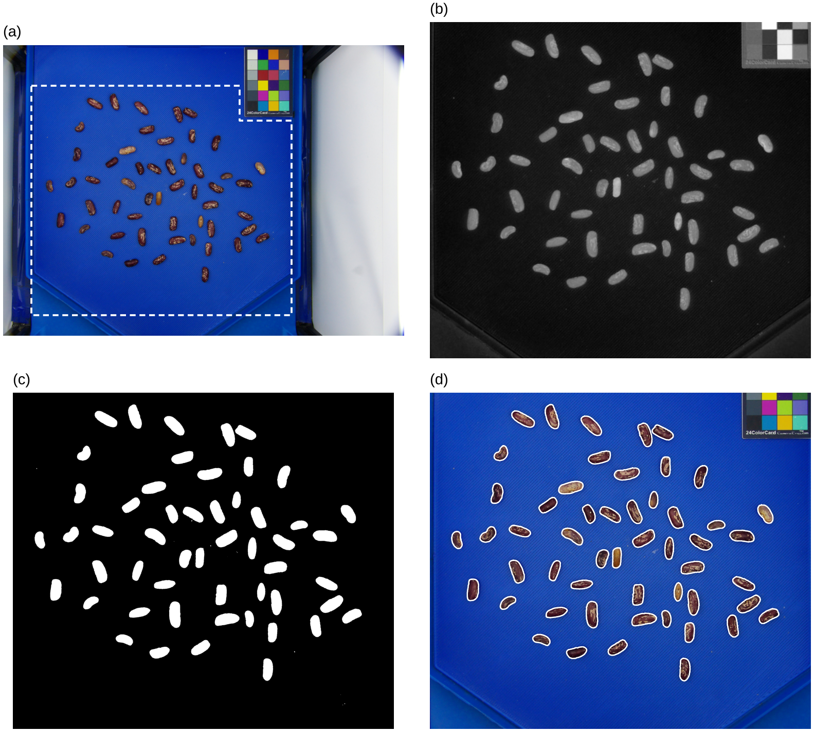

# 2. Segmentation

Segmentation assigns each pixel to an object or to the background and gives a binary mask.
FenotIT offers a threshold on one color channel, a pixel classifier trained with brush strokes
and regions proposed by MobileSAM. Object detectors are described in [section 8](08_detection.md).



*Figure 2.1. Threshold segmentation of bean seeds (drought trial). (a) Photo with the analysis
area (dashed white line). (b) b\* channel of CIELAB. (c) Mask from Otsu's threshold (b\* ≥ 99).
(d) Outlines of the 52 objects found.*

## 2.1 Color spaces

The photo is converted with OpenCV (Bradski, 2000) to RGB, HSV, CIELAB, YCrCb, HLS, CIE XYZ, YUV
or CIELUV, and the threshold is applied to one channel. The space used to segment is chosen
apart from the space used to report color (section 6).

## 2.2 Manual threshold

A pixel belongs to an object when its value in the chosen channel lies between a minimum and a
maximum. The same limits apply to every photo.

## 2.3 Automatic threshold (Otsu)

Otsu's method (Otsu, 1979) chooses, for each photo, the threshold that maximizes the
between-class variance of the channel histogram:

```latex
\sigma_B^2(t) = \omega_1(t)\,\omega_2(t)\,\left[\mu_1(t) - \mu_2(t)\right]^2
```

where $\omega$ are the shares of pixels and $\mu$ the means of the two groups. The histogram
contains only pixels inside the analysis areas and outside the excluded zones. The background is
the group that covers most of the border of the analysis area (or of the photo). The threshold is
exported as `otsu_threshold`.


*Figure 2.2. Histogram of the b\* channel inside the analysis area of Figure 2.1 (logarithmic
axis), with Otsu's threshold at 99.*

## 2.4 Segmentation by examples

The user paints strokes of each class (background and one or more object classes, such as seed
coat and spots) and a random forest (Breiman, 2001) classifies every pixel, as in ilastik (Berg
et al., 2019). Each pixel is described by 22 features: L\*, a\*, b\* and HSV saturation, and at
three Gaussian scales (σ ≈ 1, 3 and 7 px) the smoothed L\*a\*b\* color, the gradient magnitude
and the Laplacian of lightness.

A first forest uses all features; a second one, with the pixel's own color and the finest scale,
reclassifies a 14 px band around the edges found by the first. Both have 40 trees of depth 12,
with classes weighted by their number of examples (at most 6000 pixels per class). The
classification runs on a 1 MP copy (0.5 or 2 MP can be chosen) and the class probabilities are
enlarged to the full photo. Strokes from several photos form one training set.

The mask contains the classes marked as objects. Each object reports the share and area of each
class (`<class>_pct`, `<class>_area_<unit>2`), and each photo the totals.

## 2.5 Regions from MobileSAM

MobileSAM (Zhang et al., 2023), a compact Segment Anything model (Kirillov et al., 2023), runs on
the CPU with ONNX Runtime. The photo is encoded at 1024 px and the decoder is queried at points
where the color differs from a smoothed copy (local maxima of the CIELAB difference) and on a
grid (16 × 16 by default), skipping points inside accepted regions. A region is kept when its
predicted quality is at least 0.86 and its area changes by less than 8 % when the decision limit
moves. Of two regions overlapping by more than 70 %, the better one is kept; nested regions are
kept. Uncovered pixels form regions of their own.

The user assigns regions to categories by clicking. In other photos, a random forest (200 trees)
trained on the classified regions assigns them using color (mean and SD of L\*, a\*, b\*), mean
gradient, relative area (log), compactness, solidity, extent, elongation and border contact.

## 2.6 Analysis areas and excluded zones

Rectangles and polygons are stored as fractions of the photo size, for one photo or all. The
mask keeps what lies inside the analysis areas and outside the excluded zones.

## 2.7 Refining the mask

An ordered list of morphological operations with a disk of chosen diameter (Soille, 2003):
erosion, dilation, opening, closing, opening by reconstruction, hole filling and median
smoothing. Holes are filled when smaller than 0.2 times the typical object area (median of the
regions larger than 5 % of the largest); holes that touch the photo border are background. The
default list contains hole filling only.

## 2.8 Area classification

The *Classify areas* analysis classifies every pixel of the analysis area with the classifier of
section 2.4. For a class with $n$ of $N$ classified pixels, the share is $100\,n/N$ % and the
area is $n$ times the pixel area. Output columns: `class`, `pct`, `area_<unit>2` per class and
`<class>_pct`, `<class>_area_<unit>2`, `analyzed_area_<unit>2` per photo.
