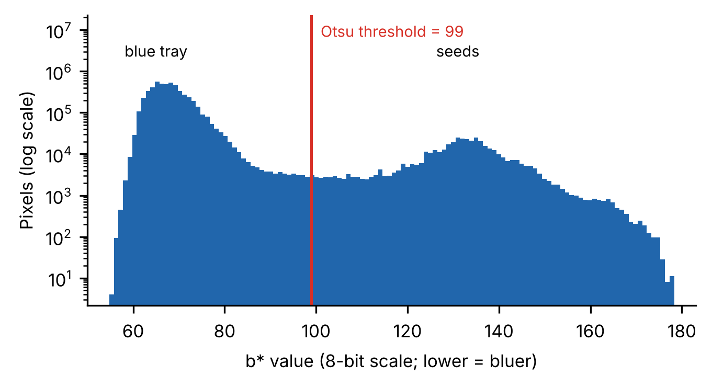
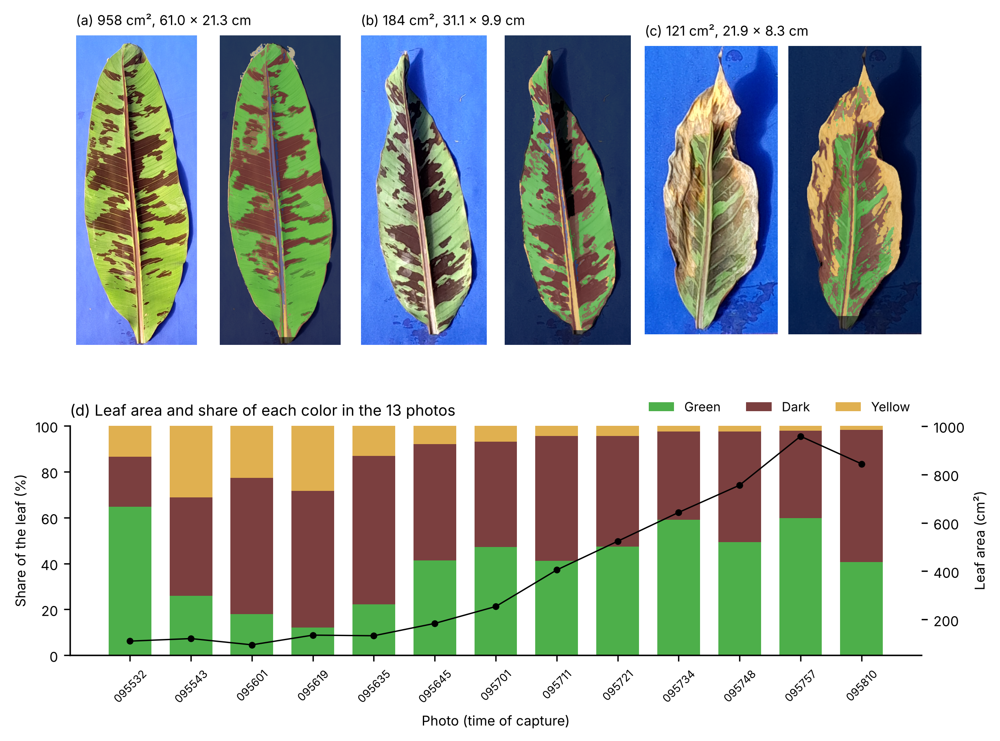

# 2. Segmentation

Segmentation decides, for every pixel, whether it belongs to an object or to the background.
The result is a binary mask. FenotIT offers three methods: a threshold on one color channel,
a pixel classifier trained with brush strokes, and regions proposed by the MobileSAM model.
Object detectors, which find objects as boxes instead of masks, are described in
[section 8](08_detection.md).

*Figure 2.1. Threshold segmentation of a tray of bean seeds (drought trial). (a) Photo with the
analysis area drawn around the seeds, leaving out the color card. (b) The b\* channel of CIELAB:
the blue tray is dark and the seeds are light. (c) Mask from the automatic (Otsu) threshold.
(d) Outline of each object found.*

## 2.1 Color spaces

The photo is converted to one of eight color spaces with OpenCV (Bradski, 2000): RGB (stored by
OpenCV as BGR), HSV, CIELAB, YCrCb, HLS, CIE XYZ, YUV and CIELUV. The threshold is applied to one
channel of the chosen space. The space used to segment is independent of the space used to
report color (section 6): segmentation needs a channel where objects and background differ,
and color reporting needs a space where differences match perception.

## 2.2 Manual threshold

A pixel belongs to an object when its value in the chosen channel lies between a minimum and a
maximum set by the user. The mask is shown over the photo while the two limits move, together
with the histogram of the channel inside the analysis area. The same limits apply to every
photo of the project.

## 2.3 Automatic threshold (Otsu)

Otsu's method (Otsu, 1979) chooses a threshold for each photo. Every possible threshold splits
the histogram of the channel into two groups of pixels; Otsu's threshold is the one where the
two groups are most different, that is, where

$$\text{(share of group 1)} \times \text{(share of group 2)} \times (\text{mean of group 1} - \text{mean of group 2})^2$$

is largest. When analysis areas are drawn, the histogram contains only the pixels inside them
(without the excluded zones), so the background outside the working surface does not shift the
threshold. Objects can be the lighter or the darker group; FenotIT takes as background the group
that covers most of the border of the analysis area (or of the photo), since objects rarely
cover the border. The threshold found for each photo is exported as `otsu_threshold`.

*Figure 2.2. Histogram of the b\* channel inside the analysis area of Figure 2.1 (8-bit scale,
logarithmic vertical axis). The tray forms the large group on the left and the seeds the small
group on the right; Otsu's threshold (99) falls between them.*

## 2.4 Segmentation by examples (pixel classifier)

When no single channel separates objects from background (leaves with lesions, mottled seeds,
uneven backgrounds), the user paints a few brush strokes of each class on the photo: background
and one or more object classes, for example healthy tissue and lesion. A random forest
(Breiman, 2001) learns from the painted pixels and classifies every pixel of the photo, in the
manner of ilastik (Berg et al., 2019).

**Features of each pixel.** Each pixel is described by 22 numbers: its L\*, a\* and b\* values
and its HSV saturation, and, at three scales (Gaussian smoothing over about 1, 3 and 7 pixels),
the smoothed L\*a\*b\* color, the strength of the lightness gradient (edges) and the Laplacian of
the lightness (spots and fine texture). The smoothed features give each pixel information about
its neighborhood.

**Two classifiers.** A first forest uses all 22 features and decides over the whole photo. Its
decisions are blurred at the edges between classes by the smoothing, so a second forest, trained
on the pixel's own color and the finest scale only, decides again in a band of 14 px around
each edge found by the first. Both forests have 40 trees of depth at most 12, with classes
weighted by their number of examples, and at most 6000 painted pixels per class are used.

**Resolution.** The classification runs on a copy of 1 megapixel by default (0.5 or 2 can be
chosen); the class probabilities are enlarged to the full photo before each pixel takes the
class of highest probability, which keeps the edges smooth. Strokes painted on several photos
are pooled into one training set, and photos without strokes are classified with it.

The mask contains the classes marked as objects. Each object then reports the area and share of
each of its classes (`<class>_pct`, `<class>_area_<unit>2`), and each photo the totals.

**Example: banana leaves.** Thirteen photos of banana leaves at different stages (Figure 2.3)
were segmented with four classes painted on two of them: the background and the three colors of
the leaf, green, dark and yellow (three to five short strokes per class). The red card in each photo measures 100 mm in
height; its height was 487.7 px (485.5 to 494.8 px in the 12 photos where it was found), which
gives a scale of 0.205 mm/px for all photos. Results are in cm and cm²:

| Photo | Leaf area (cm²) | Length (cm) | Width (cm) | Green (%) | Dark (%) | Yellow (%) |
|---|---|---|---|---|---|---|
| 095532 | 110.9 | 19.3 | 8.1 | 64.7 | 21.9 | 13.4 |
| 095543 | 121.5 | 21.9 | 8.3 | 26.0 | 42.8 | 31.2 |
| 095601 | 95.6 | 21.8 | 7.1 | 18.0 | 59.2 | 22.7 |
| 095619 | 135.7 | 25.0 | 8.8 | 12.0 | 59.7 | 28.3 |
| 095635 | 133.2 | 29.1 | 9.0 | 22.2 | 64.7 | 13.2 |
| 095645 | 184.2 | 31.1 | 9.9 | 41.3 | 50.6 | 8.0 |
| 095701 | 254.1 | 32.7 | 11.4 | 47.2 | 45.9 | 6.9 |
| 095711 | 405.1 | 37.8 | 14.5 | 41.2 | 54.3 | 4.5 |
| 095721 | 523.9 | 45.9 | 15.4 | 47.3 | 48.2 | 4.5 |
| 095734 | 643.0 | 49.9 | 17.6 | 59.1 | 38.4 | 2.5 |
| 095748 | 755.6 | 56.5 | 18.6 | 49.3 | 48.2 | 2.5 |
| 095757 | 957.8 | 61.0 | 21.3 | 59.8 | 38.0 | 2.2 |
| 095810 | 843.7 | 62.0 | 19.6 | 40.6 | 57.7 | 1.7 |

*Figure 2.3. Banana leaves segmented by examples. (a–c) Three leaves and their class map (the
leaf colors green, dark and yellow; background in blue), with the leaf area and the length and width of the
smallest enclosing rectangle. (d) Share of each color (bars) and leaf area (line) in the 13
photos, in order of capture.*

## 2.5 Regions from MobileSAM

MobileSAM (Zhang et al., 2023), a compact version of Segment Anything (Kirillov et al., 2023),
cuts the photo into regions without training. FenotIT runs it on the CPU with ONNX Runtime. The
photo is encoded once at 1024 px on its longest side, and the decoder is asked for the region
under a set of points:

- points where the color differs most from the surroundings (local maxima of the CIELAB
  difference between the photo and a strongly smoothed copy), which fall on seeds, leaves or
  lesions;
- points on a regular grid (16 × 16 by default) for large or low-contrast regions.

A point that falls inside a region already accepted is skipped. For each point the decoder
returns three candidate regions with a predicted quality; a region is kept when its predicted
quality is at least 0.86 and its outline is stable (its area changes by less than 8 % when the
decision limit of the decoder is moved up and down). When two regions overlap by more than 70 %,
the better one is kept; a region inside another (a lesion on a leaf) is kept as well. Pixels not
covered by any region form regions of their own. All regions are shown to the user, without
filters by size or position.

The user gives each region a category (for example plant, weed and soil): all regions start in
one category, a click assigns the selected category and a second click leaves the region out.
In photos without clicks, each region is classified by a random forest (200 trees) trained on the
regions classified in other photos, with features that do not depend on the resolution: mean
and standard deviation of L\*, a\* and b\*, mean lightness gradient, area as a fraction of the
photo (logarithm), compactness, solidity, extent, elongation and contact with the photo border.
With two or more categories, each object reports its category and each photo the number, area
and share of objects of each category.

## 2.6 Analysis areas and excluded zones

The user can draw rectangles or polygons, for one photo or for all photos; their coordinates are
stored as fractions of the photo size, so they apply to photos of any resolution. The mask keeps
only what lies inside the analysis areas and outside the excluded zones.

## 2.7 Refining the mask

An ordered list of operations can be applied to the mask (Soille, 2003). Each one uses a disk
of a chosen diameter in pixels and can be repeated:

| Operation | Effect |
|---|---|
| Erosion | Shrinks objects; removes specks and thin bridges |
| Dilation | Grows objects; joins nearby parts |
| Opening (erosion, then dilation) | Removes specks and thin protrusions without shrinking large objects |
| Closing (dilation, then erosion) | Fills cracks and small gaps |
| Opening by reconstruction | Removes objects smaller than the disk and leaves the outline of the others untouched |
| Fill holes | Fills holes inside objects (see below) |
| Smoothing | Median filter: smooths the outline |

**Filling holes.** A hole (background enclosed by an object, such as a bright hilum) is filled
when its area is less than 0.2 times the typical object area, taken as the median area of the
regions of the mask that measure at least 5 % of the largest. Larger holes are left as they are,
because they are usually background enclosed by a ring of touching objects. Holes that reach the
border of the photo are never filled. By default the list contains only "Fill holes".

## 2.8 Area classification

The *Classify areas* analysis classifies every pixel of the analysis area with the pixel
classifier of section 2.4 and reports the share and area of each class, without separating
objects. For a class with $n$ pixels, out of $N$ classified pixels in the analysis area
(excluded zones removed), the share is $100\,n/N$ % and the area is $n$ times the area of one
pixel (the scale squared; px² without a scale). The output has one row per class (`class`,
`pct`, `area_<unit>2`) and, per photo, `<class>_pct`, `<class>_area_<unit>2` and
`analyzed_area_<unit>2`.
