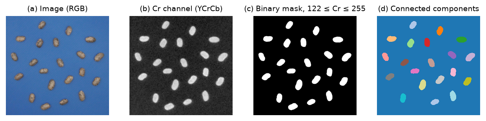
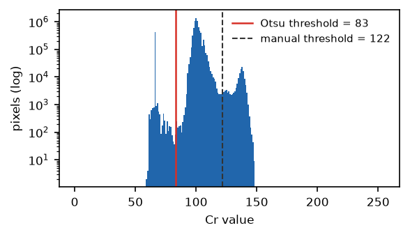

# 2. Segmentation

Segmentation separates objects from the background and produces a binary mask $B(x, y)$.

*Figure 2.1. (a) Seeds on a blue background. (b) The Cr channel of YCrCb separates the warm
seeds from the blue background. (c) Mask for 122 ≤ Cr ≤ 255. (d) 8-connected components.*

## 2.1 Color spaces

The photo (8-bit BGR) is converted to one of eight color spaces with OpenCV (Bradski, 2000):
BGR, HSV, CIELAB, YCrCb, HLS, CIE XYZ, YUV and CIELUV. One channel $I_c$ is used for the
threshold. The space used to segment is independent of the space used to report color
(section 6): segmentation only needs contrast between object and background.

## 2.2 Manual threshold

$$B(x, y) = \begin{cases} 1 & t_{min} \le I_c(x, y) \le t_{max} \\ 0 & \text{otherwise} \end{cases}$$

The interface shows the mask live over the photo while the user moves $t_{min}$ and $t_{max}$;
the same thresholds apply to every photo of the project (they belong to the capture setup).

## 2.3 Automatic threshold (Otsu)

Otsu's method (Otsu, 1979) chooses, for each photo, the threshold $t^*$ that maximizes the
between-class variance of the channel histogram:

$$t^* = \arg\max_t\ \omega_0(t)\,\omega_1(t)\,[\mu_0(t) - \mu_1(t)]^2$$

where $\omega_i$ and $\mu_i$ are the probability and mean of the two classes split at $t$.
If analysis areas are drawn, the histogram is computed only from the pixels inside them (minus
the excluded areas), so the threshold is not pulled by what lies outside. Because the object
class may be the bright or the dark one, the mask is inverted when more than half of the
border of that region (or of the image, without areas) falls in it (objects rarely cover the
border; the background does). The threshold found is exported as `otsu_threshold`.

*Figure 2.2. Histogram of the Cr channel of the same photo. Here Otsu splits off the dark
square in the corner (left mode), not the seeds (right mode). With an analysis area drawn
around the seeds, Otsu uses only those pixels and gives 117, close to the manual 122. With an
uneven background, draw an analysis area or use a manual range (the default).*

## 2.4 Analysis areas and excluded areas

The user can draw, per photo or for all photos, rectangles or polygons (coordinates stored
relative to the image size, 0–1). The mask keeps only the union of the analysis areas, minus
the excluded areas: $B \leftarrow B \land R_{incl} \land \lnot R_{excl}$.

## 2.5 Morphological operations

Before objects are separated, the user may apply one morphological operation to the mask
(Soille, 2003) with a circular structuring element $K$ of diameter $d$ px, repeated $n$ times:
erosion $B \ominus K$, dilation $B \oplus K$, opening $(B \ominus K) \oplus K$ (removes specks and
thin protrusions) or closing $(B \oplus K) \ominus K$ (fills cracks and small gaps). The
operation is applied after the analysis areas and before hole filling.

## 2.6 Cleaning

Holes inside objects (e.g. a bright hilum) are filled when their area is smaller than
0.2 × the median area of the connected components; larger holes are kept, because they are
usually background enclosed by a ring of touching objects. Holes connected to the image
border are never filled. An optional morphological opening (3 × 3) removes thin protrusions.

## 2.7 Regions from MobileSAM

In automatic mode, MobileSAM (Zhang et al., 2023), a light version of Segment Anything
(Kirillov et al., 2023), proposes regions from point prompts. The image is encoded once at
1024 px on its longest side. Prompts are placed (i) at local maxima of the CIELAB
difference between each pixel and a strongly smoothed copy of the image (things that stand
out from their surroundings, such as seeds, leaves or lesions) and (ii) on a regular grid
(16 × 16 by default) for large or low-contrast regions. Prompts that fall inside an already
accepted region are skipped. For each prompt the decoder returns three masks; a mask is kept
when its predicted IoU is ≥ 0.86 and it is stable (the area changes by less than 8 % when the
logit threshold moves from −1 to +1). Duplicates (mask IoU > 0.7) keep the best-scored mask;
a region inside another (a lesion on a leaf) is kept. Pixels not covered by any mask form
regions of their own, one per connected area, after an opening of ~1/512 of the image side
that removes the thin gaps between neighboring regions. There is no filter by size or
position: every region is shown to the user.

Each region has a category chosen by the user (for example plant, weed and soil). All
regions start in one category; a click on a region assigns the selected category, and a
second click leaves it unused. In images without clicks, each region is classified by a
random forest (200 trees, balanced class weights) trained on the regions classified by the
user in other images, with features that do not depend on image resolution: mean and SD of
CIELAB, mean gradient of L*, log of the area as a fraction of the image, compactness,
solidity, extent, elongation and contact with the image border. Unused regions are not
analyzed. With two or more categories, each object reports its category and each image
reports the number, area and share of objects in each category.

## 2.8 Area classification

The *Classify areas* analysis assigns every pixel of the analysis area to one of the classes
the user marks with brush strokes, using the same pixel classifier as segmentation by
examples (Section 2.2), and reports the share and area of each class without separating
objects. For class $c$ with $n_c$ pixels inside the analysis area $R$ (excluded zones
removed),

$$p_c = 100\,\frac{n_c}{\sum_k n_k}, \qquad A_c = n_c\,s^2,$$

where $s$ is the scale in length units per pixel ($s = 1$ without a scale, giving px²).
The output has one row per class (`class`, `pct`, `area_<unit>2`) and, per image,
`<class>_pct`, `<class>_area_<unit>2` and `analyzed_area_<unit>2`.

## 2.9 Object detectors (boxes)

A detector is a trained model that returns, for each object, an axis-aligned box, a class
and a score, instead of a mask. FenotIT runs detectors exported to ONNX on the CPU with ONNX
Runtime, reading three output layouts: YOLOv8/v11 (one tensor of $4 + C$ values per
candidate: box center, width and height in input pixels and one score per class), YOLOv5
(the same with an objectness score that multiplies the class scores) and RF-DETR/DETR (box
center, width and height as fractions of the image and one logit per class, passed through a
sigmoid). The class names are read from the model metadata or from the `data.yaml` file that
Roboflow and Ultralytics export with the weights; otherwise the user types them, one per
class in training order. PyTorch weights (`.pt`) are converted to ONNX (opset 17, fixed
input size taken from the training settings) with the tool that produced them, Ultralytics
or RF-DETR, when it is installed; the conversion runs in a separate process.

For YOLO models the image is resized without distortion to the model input (640 px by
default) and padded with gray (*letterbox*); for DETR models it is resized to the input and
normalized with the ImageNet mean and SD. Boxes are mapped back to image pixels, candidates
below the minimum confidence (0.25 by default) are dropped and, within each class, boxes that
overlap a better one with IoU > 0.5 are removed (non-maximum suppression).

A box is kept when its center lies in the analysis area and outside the excluded zones;
the size filter uses the longer side of the box as length and the shorter side as width.
Boxes are numbered by rows like objects from masks. With boxes alone, each image reports the
number of objects and the number per class, each object its class, score, center and box
width, height and area, and distances between neighbors are measured between box centers
(Section 7), with the mean nearest-neighbor distance within each class. Shape, color and
area are not measured from boxes, because a box also contains background.

**Boxes to masks.** Optionally, each box is given to MobileSAM as a box prompt (the two
corners), and the single-mask output is upsampled inside the box (with a 5 % margin) to the
image resolution. Smaller objects are drawn over larger ones. The result is one mask per
detected object with the class of its box, so every object measurement (Sections 3 to 7) and
the area per class apply. In synthetic tests with ellipses inside known boxes, the mask area
differed from the ellipse area by less than 1 %.

