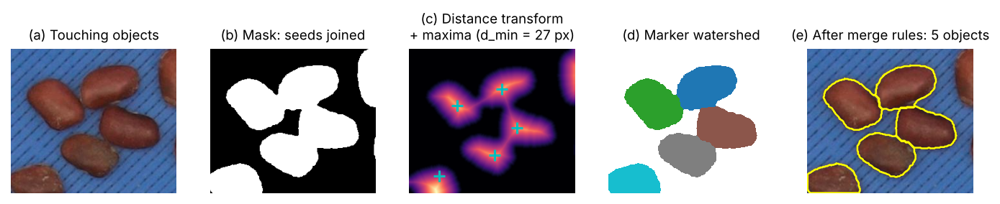

# 3. Objects

The mask is turned into numbered objects: regions are labelled, touching objects are separated,
noise and cut objects are removed, and the objects are numbered in reading order.

## 3.1 Labelling

Each 8-connected region of the mask is one object, and its outline is traced with the algorithm of
Suzuki & Abe (1985). This is the method used when "Objects touch" is off.

## 3.2 Separation of touching objects

When "Objects touch" is on, regions are split with the distance transform and a marker-based
watershed (Beucher & Meyer, 1993; Soille, 2003; van der Walt et al., 2014), followed by rules that
join parts cut by mistake and cut objects left joined.



*Figure 3.1. Separation of four touching bean seeds (drought trial). (a) The seeds. (b) Mask, one
region. (c) Distance transform with one peak per seed (crosses). (d) Watershed regions. (e) The four
objects after the joining rules.*

**Markers.** The distance transform (Euclidean, 5 × 5 mask; Borgefors, 1986) peaks near the middle
of each object at half its local thickness. Markers are peaks at least $d$ pixels apart, with $d$
equal to 0.9 times the median peak value of a first search (at least 3 px). A peak is kept when its
value is at least 0.2 times the highest value of its region.

**Shadows.** In regions at least 1.6 times the median region area, dark pixels inside the mask
(Otsu threshold on L\*) that touch the background and are large (≥ 0.1 times the typical area) or
line shaped are treated as background before the distance transform.

**Joining parts.** Two neighboring parts are joined when:

- along their common boundary the distance stays at least 0.9 times the peak distance of the
  thinner part;
- one end of the cut lies less than 0.2 times the typical radius (at least 2 px) inside the convex
  hull of both parts, and the connection is at least 0.6 times the peak distance of the thinner part;
- or one part is smaller than 0.35 times the typical area, in which case it joins the neighbor
  that shares the longest boundary.

A region smaller than 1.5 times the typical area stays as one object.

**Cutting at notches.** Objects at least 1.6 times the median area are tested for straight cuts
between two notches deeper than 0.25 times the typical radius, or between a notch and the
opposite side. Each cut is scored as

```latex
\text{score} = \min_{\text{parts}} S \;-\; 0.1 \sum_{\text{parts}} \left| \frac{A_{\text{part}}}{A_{\text{typical}}} - 1 \right| \;-\; 0.01\,\frac{L_{\text{cut}}}{r_{\text{typical}}}
```

where $S$ is the solidity of a part, $A$ its area and $L_{\text{cut}}$ the cut length. The best cut is
made when both parts have a solidity of at least 0.85 and at least 0.03 above that of the whole
object, up to three cuts per object.

Objects from a split region carry `touching = 1`. They are counted, and size and shape are
measured on isolated objects unless "Measure touching objects" is on.

## 3.3 Filters

- **Noise:** objects smaller than 0.01 % of the photo and smaller than 5 % of the typical object
  (area-weighted median) are removed.
- **Border:** objects that touch the photo edge can be excluded.
- **Size:** optional minimum and maximum length and width in the unit of the scale.
- **Manual exclusion:** an object excluded in the inspector keeps its number and gets
  `status = excluded`; it is stored as a point in relative coordinates and applied on every run.

## 3.4 Numbering

Objects are numbered from 1 in reading order: the row is the centroid height divided by the median
bounding-box height, rounded, and objects within a row go from left to right.

## 3.5 Objects in analysis areas

With analysis areas drawn, each object gets the area that contains its centroid, or the area with
most of its pixels (`analysis_area`). The table `areas` gives the number of objects and the size of
each area.
