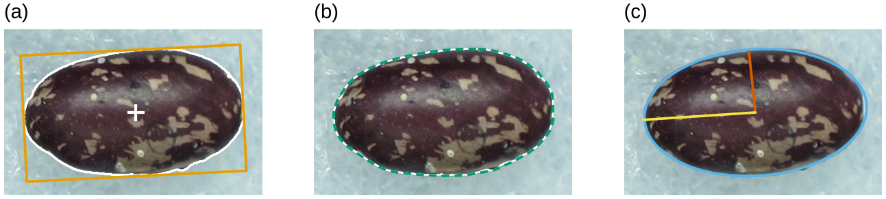

# 4. Morphometry

Size and shape descriptors are computed for each object. Objects that come from a split region
(`touching = 1`, section 3.2) are counted and measured only when "Measure touching objects" is
on. The outer outline of each object is traced with the algorithm of Suzuki & Abe (1985).

*Figure 4.1. Geometry measured on one mottled bean seed from a Petri dish photo (bruchid trial,
section 8.5). (a) Outline
(yellow), smallest enclosing rectangle (red) and centroid (cross). (b) Convex hull (green), the
outline of the seed with every concavity bridged. (c) Ellipse fitted to the outline (blue), and
the shortest (red) and longest (green) distances from the centroid to the outline.*

## 4.1 What is measured

- **Area**: number of pixels of the object.
- **Perimeter**: length of the outline after simplifying it with the Douglas–Peucker algorithm
  with a tolerance of 1 px (Douglas & Peucker, 1973). The raw pixel outline follows the steps of
  the pixel grid, which add length on curved and oblique edges; the simplification removes the
  steps and keeps the shape.
- **Polygon area**: area enclosed by the outline polygon. The ratios below use it together with
  the perimeter, so that both come from the same polygon.
- **Convex hull**: the smallest convex polygon that contains the outline (Sklansky, 1982), with
  its own area and perimeter.
- **Length and width**: the long and short sides of the smallest rectangle, at any angle, that
  encloses the object (Freeman & Shapira, 1975; found with rotating calipers, Toussaint, 1983).
  They are the length and width a caliper would give.
- **Ellipse axes**: full lengths of the major and minor axes of the ellipse fitted to the
  outline by least squares (Fitzgibbon & Fisher, 1995).
- **Centroid**: mean position of the object pixels.
- **Radii**: distances from the centroid to each point of the outline.

## 4.2 Exported descriptors

Lengths are multiplied by the scale (unit per pixel) and areas by the scale squared; the unit is
part of the column name (`<u>` is `mm`, `um`, `cm`, `m` or `px`). Ratios have no unit.

| Column | Definition | Values |
|---|---|---|
| `area_<u>2` | Area | > 0 |
| `length_<u>`, `width_<u>` | Length and width of the smallest enclosing rectangle | > 0 |
| `perimeter_<u>` | Perimeter | > 0 |
| `aspect_ratio` | length / width | 1 for an object as wide as long, larger for longer objects |
| `elongation` | 1 − width / length | 0 for an object as wide as long, close to 1 for a thin one |
| `circularity` | 4π × polygon area / perimeter², at most 1 (Cox, 1927) | 1 for a disk, lower for long or irregular outlines |
| `solidity` | polygon area / convex hull area | 1 for a convex object, lower with notches and concavities |
| `convexity` | convex hull perimeter / perimeter, at most 1 | 1 for a smooth convex outline, lower for rough or lobed ones |
| `rectangularity` | polygon area / (length × width) | 1 for a rectangle, about 0.785 for an ellipse |
| `eccentricity` | √(1 − (minor axis / major axis)²) of the fitted ellipse | 0 for a circle, close to 1 for a thin ellipse |
| `major_axis_<u>`, `minor_axis_<u>` | Ellipse axes | > 0 |
| `radius_min_<u>`, `radius_mean_<u>`, `radius_max_<u>` | Shortest, mean and longest radius | > 0 |
| `radius_ratio` | shortest radius / longest radius | 1 for a disk |
| `centroid_x_px`, `centroid_y_px` | Centroid, in pixels from the top-left corner | |

The definitions follow the usual conventions of image analysis (Russ & Neal, 2016), the same
used by ImageJ (Schneider et al., 2012) and CellProfiler (Stirling et al., 2021).

## 4.3 Values per photo

| Column | Meaning |
|---|---|
| `n_objects` | Objects counted (manually excluded objects are not counted) |
| `n_touching` | Objects that come from a split region |
| `n_measured` | Objects with size and shape measurements |
| `n_excluded_manual`, `n_highlighted` | Objects excluded or highlighted in the inspector |

Legends and charts summarize each descriptor with the mean and the sample standard deviation
(SD, computed with n − 1).
