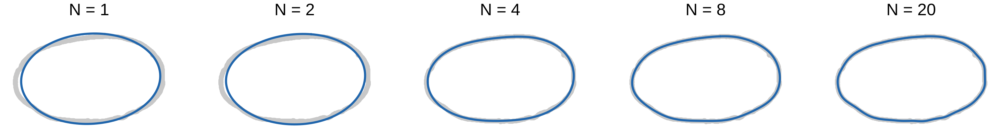

# 5. Outline shape: elliptic Fourier descriptors

Each outline is described with elliptic Fourier descriptors (EFD; Kuhl & Giardina, 1982), as used
for seed and leaf outlines (Iwata & Ukai, 2002).



*Figure 5.1. Outline of the seed of Figure 4.1 (gray) and its reconstruction (blue) with N = 1, 2,
4, 8 and 20 harmonics. FenotIT uses 20 by default.*

## 5.1 Coefficients

The x and y coordinates along the outline are periodic and are written as Fourier series. Harmonic
$n$ has four coefficients and traces an ellipse; the sum of the harmonics rebuilds the outline. For
an outline of $K$ points, perimeter $T$, arc length $t_p$ at point $p$ and steps $\Delta x_p$,
$\Delta y_p$, $\Delta t_p$:

```latex
a_n = \frac{T}{2 n^2 \pi^2} \sum_{p=1}^{K} \frac{\Delta x_p}{\Delta t_p}\left[\cos\frac{2\pi n t_p}{T} - \cos\frac{2\pi n t_{p-1}}{T}\right]
b_n = \frac{T}{2 n^2 \pi^2} \sum_{p=1}^{K} \frac{\Delta x_p}{\Delta t_p}\left[\sin\frac{2\pi n t_p}{T} - \sin\frac{2\pi n t_{p-1}}{T}\right]
```

$c_n$ and $d_n$ use $\Delta y_p$ in place of $\Delta x_p$. With $N$ harmonics the outline around its
centroid is

```latex
x(t) = \sum_{n=1}^{N} \left( a_n \cos\frac{2\pi n t}{T} + b_n \sin\frac{2\pi n t}{T} \right)
y(t) = \sum_{n=1}^{N} \left( c_n \cos\frac{2\pi n t}{T} + d_n \sin\frac{2\pi n t}{T} \right)
```

An outline needs at least $2N + 2$ points.

## 5.2 Normalization

Using the first harmonic's ellipse, the starting point is moved to the end of its major axis, the
outline is rotated so that this axis lies along x, and all coefficients are divided by its
semi-major axis. Then $a_1 = 1$, $b_1 = c_1 = 0$ and $|d_1|$ is the axis ratio of the first ellipse.
The $4N$ coefficients are exported in `object_shape` (`efd_a1` to `efd_dN`).

## 5.3 Alignment and mean shape

Within each group (a photo, a batch or a genotype), each outline is replaced by the version (as it
is, turned 180° or mirrored) closest to the group mean in Euclidean distance between coefficients,
starting from the first object and repeating three times. The mean shape is the mean of the aligned
coefficients. The inspector shows each object's distance to the mean next to the median distance
of the photo.
