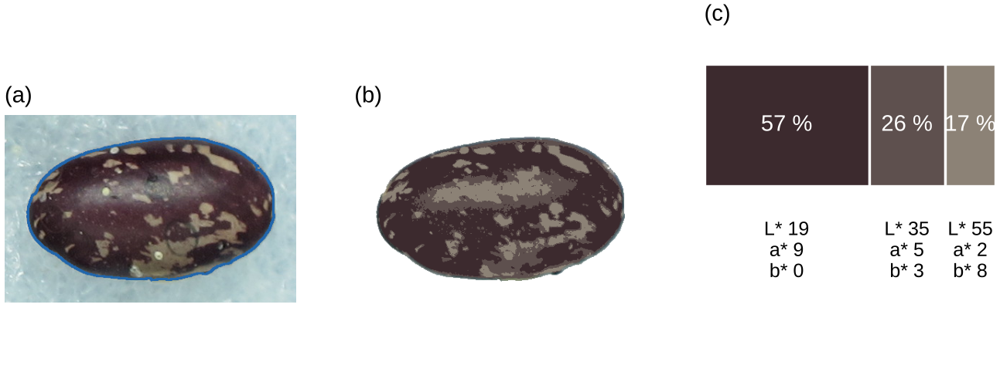
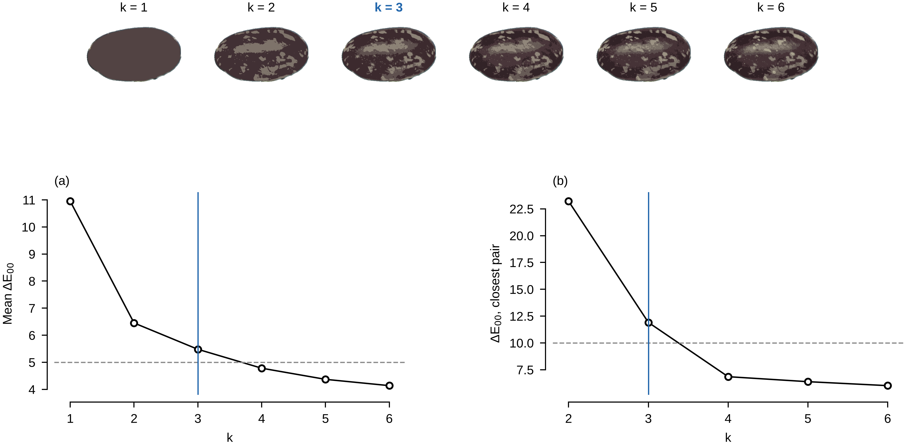

# 6. Color

FenotIT reports the mean color of each object and its dominant colors, found by grouping its
pixels with k-means. The number of dominant colors can be set by the user or chosen for each
object.

*Figure 6.1. Color of the seed of Figure 4.1. (a) The edge of the seed (magenta) is removed
before measuring. (b) Each remaining pixel painted with the color of its group, with three
groups. (c) The three colors, their share of the seed and their CIELAB values.*

## 6.1 Pixels used

Pixels on the outline mix the object and the background, because of optical blur and the color
interpolation of the camera sensor. A ring is removed from the edge of each object by erosion
with a 3 × 3 square; its width in pixels is 1.5 % of the square root of the object area,
rounded and kept between 1 and 3 px. The width of the mixed edge depends on the blur, which
spans 1 to 3 px, more than on the object size, so the ring stays thin on large leaves. When
fewer than 20 pixels remain, the whole object is used.

## 6.2 Mean color

The mean color is the mean of the remaining pixels in RGB (`mean_R`, `mean_G`, `mean_B`), also
given in CIELAB (`mean_L`, `mean_a`, `mean_b`).

## 6.3 Dominant colors with a fixed number

The pixels are grouped in RGB into $k$ groups with k-means (Lloyd, 1982): each pixel belongs to
the group whose mean color is closest, and each group color is the mean of its pixels; the two
steps alternate until the colors stop changing. The starting colors are chosen with k-means++
(Arthur & Vassilvitskii, 2007), the grouping is repeated three times from different starts and
the best result is kept, with a fixed random seed so the same object always gives the same
colors. The groups are found on at most 3000 pixels taken at random from the object, and then
every pixel is assigned to its closest group color. Groups are listed from the largest to the
smallest share of pixels (`pct`, %). By default $k$ is 3 for objects and 5 for whole photos; an
object with fewer distinct colors than $k$ gets fewer groups.

Two modes are available:

- **Each object** (`object`): each object gets its own colors, which describes the pattern of
  that object (for example, a mottled seed).
- **All objects together** (`pooled`): one set of colors is found with the pixels of all
  objects of the photo, and each object is described by the share of each common color. All
  objects are then described with the same colors in different proportions.

The colors of the whole photo (all objects together) are always exported (`image_colors`).

## 6.4 Number of colors chosen for each object

With "Automatic", each object gets the number of colors that describes it, up to the maximum set
by the user. The pixels are grouped in CIELAB for $k = 1, 2, 3, \dots$, and for each $k$ three
quantities are computed with the CIEDE2000 color difference (ΔE₀₀; Sharma et al., 2005; see
section 1.3):

- **Fit**: the mean ΔE₀₀ between each pixel and the color of its group. It falls as $k$ grows.
- **Separation**: the ΔE₀₀ between the two closest group colors. It falls as $k$ grows.
- **Smallest share**: the share of pixels of the smallest group.

The number chosen is the smallest $k$ whose fit is 5 ΔE₀₀ or less, unless before that the next
$k$ would give two colors closer than 10 ΔE₀₀ or a group with less than 1 % of the pixels; then
the last $k$ before that point is chosen. On the scale described in section 1.3, both limits are
differences seen at a glance: the colors chosen are distinct from each other, and each one
represents its pixels within a difference of that size. The quantities are computed on 1500 pixels of the object
taken with a fixed random seed.

*Figure 6.2. Number of colors for the seed of Figure 6.1. Top: the seed painted with 1 to 6
colors. (a) Mean ΔE₀₀ between each pixel and its group color; the dashed line is the limit of 5.
(b) ΔE₀₀ between the two closest colors; the dashed line is the limit of 10. Three colors are
chosen.*

For this seed the fit is 11.0 ΔE₀₀ with one color, 6.4 with two and 5.5 with three. With four
colors the fit reaches 4.8, but two of the four colors are only 6.9 ΔE₀₀ apart (with three
colors the closest two are 11.9 apart), so three colors are chosen: the dark purple seed coat
(57 %), an intermediate tone on the reflection and at the borders of the mottles (26 %), and the
light beige mottles (17 %). In the 15 seeds of the photo, the number chosen was 2
for one seed, 3 for five, 4 for eight and 5 for one, following how much light mottling each
seed has.

## 6.5 Color spaces for reporting

Color is reported and plotted in CIELAB by default (CIE, 2004). In CIELAB, distances agree
approximately with perceived differences: L\* is the lightness (0 to 100), a\* goes from green
(negative) to red (positive) and b\* from blue (negative) to yellow (positive). The conversion
uses OpenCV and assumes sRGB with the D65 illuminant. The color charts can also show RGB (0 to
255) and HSV (hue 0 to 360°, saturation and value 0 to 100).

Colors are comparable between photos taken under the same light and camera settings, or
corrected with a color card (section 1.3).

## 6.6 Color charts

- **2D**: the a\*–b\* plane (the chromaticity diagram), drawn with equal scales on both axes so
  that distances on the chart are color differences.
- **3D**: the three axes of CIELAB, RGB or HSV, which can be rotated and zoomed.
- One point per color, per object or per photo. An object or photo point is placed at its mean
  color (averaged in CIELAB and weighted by share) and drawn as a small pie whose slices are its
  dominant colors and their shares. The point size is proportional to its share of the area.
