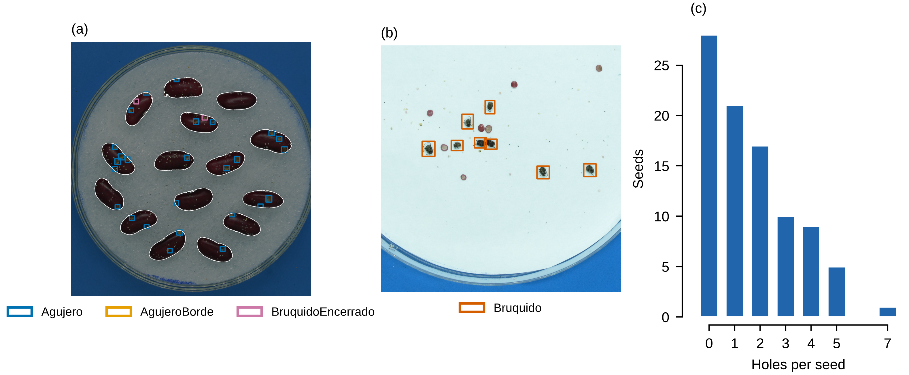

# 7. Detection models

A detection model finds objects as boxes, each with a class and a confidence. FenotIT runs models
trained by the user on the CPU and uses the boxes as the objects of the analysis (*Detection*) or
counts them inside the objects of a mask (*Detections per object* in *Objects*).

*Figure 7.1. A bruchid detection model (RF-DETR, five classes). (a) Seed outlines from the mask
(white) and the boxes found in each seed, by class. (b) Detection analysis: adult bruchids in a
Petri dish. (c) Holes (class Agujero) per seed in six photos (91 seeds).*

## 7.1 Models

Models are ONNX files run with ONNX Runtime, in two output formats:

- **YOLO** (YOLOv5, YOLOv8, YOLO11): box center, width, height and class scores per candidate
  (YOLOv5 multiplies them by its objectness score), or the final boxes with corners, score and
  class.
- **DETR** (RF-DETR, DETR): boxes as fractions of the input and class logits, converted with the
  logistic function; a reserved first column is dropped when there is one more score than class
  names.

Format, input size and class names are read from the file or from the training `data.yaml`.
PyTorch models (`.pt`) are converted to ONNX with Ultralytics (opset 17, training image size) or
RF-DETR, in a separate Python environment that FenotIT installs on request. Each model has a record
(name, description, owner, license, source, citation) exported as `model_*` in `metadata.csv`, is
stored encrypted and can be shared as a `.fntm` package.

## 7.2 Running a model

YOLO inputs are letterboxed (resized keeping proportions with bilinear interpolation and padded
with gray); DETR inputs are resized to the square input and normalized with the ImageNet mean and
SD. Boxes below the minimum confidence (0.25 by default) are dropped, and per-class non-maximum
suppression removes overlapping boxes (IoU > 0.5). The user chooses which classes are used.

## 7.3 Detection analysis

Each box is one object and goes through analysis areas, filters, manual exclusion and numbering
(section 3). Objects report class, confidence and box size; photos report `n_objects` and
`n_<class>`. With "Convert boxes to masks", each box prompts MobileSAM (section 2.5) and the region
cut to the box enlarged by 5 % becomes the object, which can then be measured as any mask.

## 7.4 Detections per object

Each box is assigned to the object that contains its center or, if the center is on the
background, to the object with most pixels inside the box. Objects report `n_<class>`; photos
report the totals and `mean_<class>_per_object`. The table `detections` lists every box.

## 7.5 Application: bruchid damage in bean seeds

Seed samples from a bruchid study of the Alliance bean program and the adults that emerged from
them were photographed in Petri dishes on a blue background (3648 × 2736 px). An RF-DETR Small model
(512 px) detects five classes: *Agujero* (hole), *AgujeroBorde* (hole on the seed edge),
*AgujeroCerrado* (closed hole), *Bruquido* (adult) and *BruquidoEncerrado* (adult inside the seed).
Converted in FenotIT, it gave the same boxes and classes as RF-DETR in Python (IoU ≥ 0.98).

Six seed photos were analyzed with Objects (threshold on L\* 0 to 160 inside the dish, holes filled)
and detections per object (confidence ≥ 0.5): 91 seeds with 153 holes, 1.68 per seed on average
and at most 7, and 69 % of the seeds with at least one hole (Figure 7.1c). Three photos of adults
analyzed with Detection (class Bruquido) gave 30, 8 and 20 adults (Figure 7.1b).
