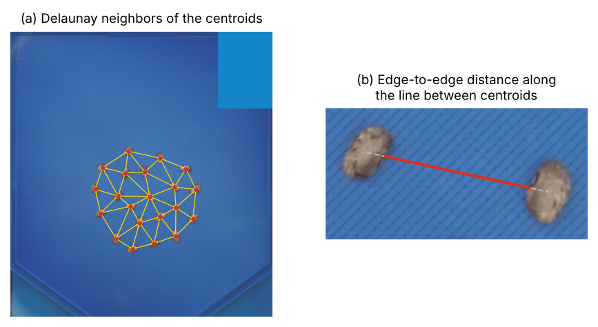

# 7. Spatial pattern: neighbor distances

The *Distances* analysis describes how objects are arranged: the free space between each
object and its neighbors, and whether the pattern is clustered, random or regular.

*Figure 7.1. Neighbor distances in the seed tray of Figure 2.1. (a) Neighbors defined by the
Delaunay triangulation of the centroids. (b) The default distance between two neighbors: the
free space between their outlines along the line joining the centroids (red); the gray dashes
are the parts of that line inside the seeds.*

## 7.1 Neighbors

Each object is represented by its centroid. Two definitions of neighbor are available:

- **Nearest** (`knn`): the $k$ nearest centroids of each object (5 by default), found with a
  k-d tree. A pair of objects is counted once, whether one or both are among the nearest of the
  other.
- **Voronoi network** (`voronoi`): the sides of the Delaunay triangulation of the centroids
  (Delaunay, 1934). Two objects are neighbors when no other object lies between them; each
  object is joined to the objects around it in every direction, with no parameter to set.

## 7.2 Distance between two neighbors

| Option | Definition |
|---|---|
| Edge to edge (default) | Length of the part of the segment between centroids that lies outside both objects |
| Closest point | Minimum distance between the two outlines (nearest-neighbor search between contour points) |
| Center to center | Euclidean distance between centroids |

The center-to-center distance is always exported as well. A pair whose segment crosses a
third object is flagged (`crosses_object = 1`) and not drawn.

## 7.3 Per object and per photo

- Per object: `nearest_<u>` (distance to its closest neighbor), `mean_neighbor_<u>` and
  `n_neighbors`.
- Per photo: mean, SD, minimum and maximum of the nearest-neighbor distances (one value per
  object), the mean distance over all neighbor pairs (`mean_pair_<u>`), and the Clark–Evans index.

## 7.4 Clark–Evans aggregation index

The Clark–Evans index (Clark & Evans, 1954) compares the observed distances with those of
objects placed at random. Take $n$ objects in an area $A$ (the analysis area if one was drawn,
otherwise the whole photo), so that the density is $n / A$ objects per unit area. Let
$\bar d$ be the observed mean distance from each centroid to its nearest centroid. If the same
number of objects were scattered at random over the same area, that mean distance would be
expected to be

$$\bar d_{\text{random}} = \frac{1}{2}\sqrt{\frac{A}{n}}$$

The index is the ratio of the two:

$$R = \frac{\bar d}{\bar d_{\text{random}}}$$

$R$ below 1 means that objects are closer together than at random (clustered), $R$ near 1 a
random pattern, and $R$ above 1 that objects keep their distance from each other (regular),
up to 2.149 for objects on a hexagonal grid. To judge whether $R$ differs from 1 more than
chance would explain, $z$ is the difference between $\bar d$ and $\bar d_{\text{random}}$
divided by the standard error of the random mean distance:

$$z = \frac{\bar d - \bar d_{\text{random}}}{0.26136 \, \sqrt{A} \, / \, n}$$

The pattern differs from random at the 5 % level when $z$ is below −1.96 or above 1.96.

The index has no edge correction (Donnelly, 1978): objects near the edge of the area find
their nearest neighbor farther away than objects in the middle, which raises $R$ slightly when
there are few objects. An analysis area drawn closely around the objects keeps this effect
small.

## 7.5 Objects with classes

When objects have a class (regions with a category, section 2.5, or detections, section 8),
each pair also reports `class_a` and `class_b`, and each photo reports, for every class, the
mean distance from each object to its nearest neighbor of the same class
(`mean_nearest_<class>_<unit>`, between centroids; empty when the class has fewer than two
objects).

## 7.6 Distances between detections

With the option "Objects from a detection model", the objects are the boxes found by a detection model
(section 8) instead of the regions of a mask. The Detect step replaces the Segment step, and
distances are measured between box centers. This gives, for example, the spacing between
insects, lesions or seedlings detected in a photo.
