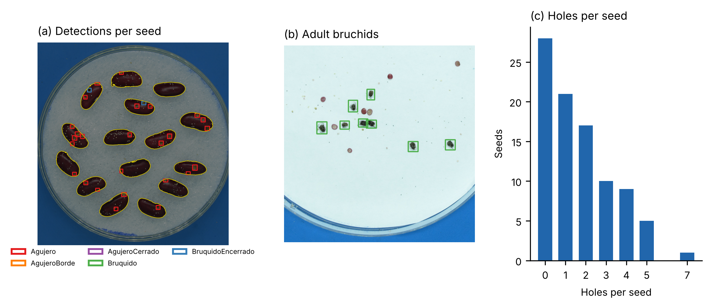

# 8. Detection models

A detection model finds objects as boxes, each with a class and a confidence, instead of
classifying pixels. FenotIT runs detection models trained by the user (for example with
Roboflow or Ultralytics) on the CPU and without internet, and uses them in two ways: the boxes
are the objects of the analysis (*Detection* analysis), or the boxes are counted inside the
objects of a mask (*Detections per object* in the *Objects* analysis).

*Figure 8.1. A bruchid detection model (RF-DETR, five classes) in FenotIT. (a) Objects analysis
with detections per object: seed outlines from the mask (yellow) and the boxes found in each
seed, colored by class. (b) Detection analysis: adult bruchids in a Petri dish, each box is one
object. (c) Number of holes (class Agujero) per seed in six photos of seed samples (91
seeds).*

## 8.1 Models

A model is an ONNX file read with ONNX Runtime. Two output formats are read:

- **YOLO** (Ultralytics YOLOv5, YOLOv8 and YOLO11): one output with, for each candidate box,
  its center, width and height in pixels of the model input and a score per class (YOLOv5 adds
  an objectness score, which multiplies the class scores), or the final list of boxes with
  corners, score and class.
- **DETR** (RF-DETR, DETR): two outputs, the boxes (center, width and height as fractions of
  the input) and a score per class for each box, converted to probabilities with the logistic
  function. When the scores have one more column than the model has class names, the first
  column is a reserved index and is dropped.

The format, the input size and the class names are read from the file when it carries them (the
class names that Ultralytics stores in the metadata, or the `data.yaml` of the training set).
Models in PyTorch format (`.pt`) are converted to ONNX by FenotIT with the tool that trained
them: Ultralytics (export with opset 17 at the training image size) or RF-DETR (loaded from the
checkpoint and exported). The conversion runs in a separate Python environment that FenotIT
can install with one button; Ultralytics and RF-DETR live in that environment, apart from FenotIT.

Each model has a record with its name, description, owner, license, source and citation, filled
in when it is added and exported with the results (`model_*` in `metadata.csv`). Models are
stored encrypted in FenotIT's data folder and can be shared with other FenotIT users as a
`.fntm` package.

## 8.2 Running a model

- **YOLO**: the photo is reduced to the input size keeping its proportions, and the rest of the
  square input is filled with gray (letterbox). The boxes are taken back to photo pixels by
  undoing the reduction and the offset.
- **DETR**: the photo is resized to the square input with bilinear interpolation and normalized
  with the ImageNet mean and standard deviation, as in RF-DETR.

Boxes with a confidence below the minimum set by the user (0.25 by default) are dropped. When
two boxes of the same class overlap with an intersection over union above 0.5, the one with the
lower confidence is dropped (non-maximum suppression). The user can choose which classes are
used.

## 8.3 Detection analysis

Each box is one object. The objects go through the same steps as the regions of a mask (section
3): analysis areas, border and size filters, manual exclusion and numbering. Each object reports
its class, its confidence and the width, height and area of its box; each photo reports the
number of objects, in total and per class (`n_<class>`). Distances between objects (section 7.6)
are measured between box centers.

With "Convert boxes to masks", each box is given to MobileSAM (section 2.5) as a prompt, and the
region it returns, cut to the box enlarged by 5 %, becomes the object. The objects then have an
outline, and size, shape and color can be measured as for any mask (sections 4 to 6).

## 8.4 Detections per object

In the Objects analysis, "Detections per object" runs a detection model on the same photo and
assigns each box to an object of the mask:

- to the object that contains the center of the box;
- if the center falls on the background, to the object with the most pixels inside the box;
- if no object pixel falls inside the box, the box stays unassigned.

Each object reports the number of boxes of each class (`n_<class>`); each photo reports the
total of the assigned boxes per class (`n_<class>`) and the mean per object (`mean_<class>_per_object`). The table
`detections` lists every box with its object, class, confidence and corners.

## 8.5 Application: bruchid damage in bean seeds

Bruchids (Coleoptera: Chrysomelidae, Bruchinae) lay their eggs on bean seeds; the larvae develop
inside the seed and the adults leave through round exit holes. In a bruchid study of the
Alliance bean program, seed samples and the adults that emerged from them were photographed in
Petri dishes on a blue background (3648 × 2736 px). An RF-DETR Small model (input 512 px),
trained on photos of this study, detects five classes: *Agujero* (hole),
*AgujeroBorde* (hole on the edge of the seed), *AgujeroCerrado* (closed hole), *Bruquido*
(bruchid) and *BruquidoEncerrado* (bruchid enclosed in the seed).

The model was converted to ONNX in FenotIT and its output was compared with RF-DETR run in
Python on the same photos: both gave the same boxes and classes (intersection over union of each
pair of boxes ≥ 0.98), and the only differences were boxes whose confidence lies at the
threshold.

**Holes per seed.** Six photos of seed samples were analyzed with the Objects analysis
(threshold on L\* of CIELAB, 0 to 160; the analysis area is the inside of the dish; holes in the
mask filled) and detections per object (minimum confidence 0.5). The 91 seeds had 153 holes in
total (class Agujero), 1.68 per seed on average and at most 7; 69 % of the seeds had at least
one hole (Figure 8.1c). The model also found 4 holes on the edge of a seed and 9 enclosed
bruchids.

**Adults.** Three photos of emerged adults were analyzed with the Detection analysis, class
Bruquido only: 30, 8 and 20 adults (Figure 8.1b).
